# GPO で Firefox の自動更新を配る手順(コンピューターの構成)

Active Directory のグループポリシー(GPO)で、ドメインに参加している Windows 11 の Firefox に「自動更新を有効にする」設定を配る手順です。
**コンピューターの構成(コンピューターポリシー)** で配ります。ユーザーごとの設定は使いません。

設定の入れ方は 2 通りあります。どちらも検証環境を 1 から作って再現し、その画面を撮ってあります(2026-10-16 JST)。

- **方法 A: ADMX(管理用テンプレート)を使う** ← おすすめ
- **方法 B: ADMX を使わず、GPO の「基本設定」のレジストリで直接値を入れる**

## 結論

- Firefox の自動更新を効かせているのは、PC のレジストリ値 `HKLM\SOFTWARE\Policies\Mozilla\Firefox` の `AppAutoUpdate`(DWORD、`1`)です。GPO はこの値を PC に配っているだけです。
- 方法 A でも B でも、この値が PC に入り、Firefox の `about:policies` に `AppAutoUpdate = true` と出ます(どちらも実際に確認済み)。
- ADMX は、この値を GPO エディターで「項目」として選べるようにする定義ファイルです。**値そのものを可能にするものではありません**(下の「ADMX とは」)。

## ADMX とは

- **ADMX は、GPO エディターの「管理用テンプレート」に出す設定項目を定義する XML ファイルです。**
  設定の名前、説明、どのレジストリのどの値に書くか、値の種類(有効/無効、数値、文字列など)が書かれています。
- **ADML は、画面に出す文字(項目名や説明)を言語ごとに持つファイルです。** `en-US` などのフォルダーに入っていて、ADMX とセットで使います。
- Windows 標準の項目は、最初から Windows に入っている ADMX で出ています。**Firefox のようなアプリの項目は、アプリの提供元が配る ADMX を自分で追加して初めて出ます。**
- ADMX は「設定画面の部品」です。実際に効くのは、GPO が PC に配るレジストリ値と、それを読むアプリ(ここでは Firefox)の機能です。
  Firefox の ADMX(`firefox.admx`)には、たとえば `AppAutoUpdate` という項目が「`Software\Policies\Mozilla\Firefox` の `AppAutoUpdate` に書く」と定義されています。
- ADMX を置かなくても、同じキーと値の名前を自分で指定してレジストリ値を配れば、同じ設定になります(方法 B。実際に確認済み)。

### ADMX のダウンロード先(Firefox)

- **`https://github.com/mozilla/policy-templates/releases`**(Mozilla 公式の policy-templates の配布ページ)
- 最新のリリースにある `policy_templates_vX.Y.zip` をダウンロードして解凍します(今回は v8.4)。
- 解凍した中の `windows` フォルダーに必要なファイルがあります。
  - `firefox.admx`、`mozilla.admx`(定義ファイル)
  - 言語フォルダー(v8.4 では `de-DE`、`en-US`、`fr-FR`、`ru-RU`)の中の `firefox.adml`、`mozilla.adml`
  - v8.4 には日本語(`ja-JP`)がありません。そのため GPO エディターの項目名と説明は**英語**で表示されます。
- PowerShell でダウンロードする場合は、付録を見てください。

## どちらの方法がおすすめか

| | 方法 A: ADMX を使う | 方法 B: 基本設定のレジストリ |
|---|---|---|
| 事前準備 | ADMX を中央ストアに置く | 不要 |
| 設定の入れ方 | 項目を選んで「有効」にする | キー・値の名前・種類・データを自分で入力する |
| 入力ミス | 項目名と説明が出るので、間違えにくい | 手入力なので、名前を打ち間違えても保存できてしまう(その場合 Firefox は設定を認識しない) |
| 項目の説明 | 画面に出る(英語) | 出ない |
| 他の Firefox 設定を足すとき | 同じ画面から選べる | 設定ごとに手でレジストリ項目を作る |
| GPO のリンクを外したとき | 値が消えることを確認済み | **この検証では未確認**(基本設定の値は、一般に GPO を外しても残る動作と説明されることが多い。必ず自分の環境で確かめること) |
| 中央ストアの注意 | 初めて作るときは Windows 標準のテンプレートをコピーしておく | 関係なし |

**おすすめは方法 A です。** 画面で項目の名前と説明を見ながら設定でき、打ち間違えにくく、あとから他の Firefox の設定を足すのも楽だからです。
方法 B は、ADMX を管理したくない場合(中央ストアを触りたくない、設定が 1 つだけで済む、など)に向いています。その場合は、キーと値の名前を正確に入力してください。

## 検証環境(この手順を再現した構成)

| 項目 | 内容 |
|---|---|
| ハイパーバイザー | Proxmox VE 9.1.1 の仮想マシン 2 台 |
| ドメインコントローラー | Windows Server 2025 Standard 評価版(デスクトップエクスペリエンス)、ホスト名 `LABDC01`、固定 IP `<DCのIPアドレス>` |
| ドメイン | `lab.local`(NetBIOS 名 `LAB`、機能レベル Windows Server 2025) |
| クライアント | Windows 11 Pro 25H2(ビルド 26200)、ホスト名 `LABWIN11`、ドメイン参加済み |
| 対象 OU | `OU=Workstations,DC=lab,DC=local`(`LABWIN11` はこの中) |
| Firefox | 158.0(64 ビット、日本語、MSI 版を `https://download.mozilla.org/?product=firefox-msi-latest-ssl&os=win64&lang=ja` から入手) |
| ADMX テンプレート | Mozilla `policy-templates` v8.4 |
| 操作に使ったアカウント | DC: `LAB\Administrator`(ドメイン管理者)/ クライアント確認: `LAB\labuser`(一般ユーザー) |

あなたの環境に置き換えるときは、`lab.local` を自社のドメイン名、`Workstations` を対象 PC の OU 名に読み替えてください。

## 前提

- ドメインコントローラーに、ドメイン管理者(または GPO を作成できる権限)でサインインできる。
- 対象の PC がドメインに参加していて、**対象の OU に入っている**(OU に入っていない PC には、リンクしても配られません)。
- Firefox は 75 以降、または ESR 68.7 以降(この設定が使えるバージョン。GPO エディターの説明欄に出ます)。

## 手順 1. GPO を作り、対象の OU にリンクする(方法 A・B 共通)

1. DC にドメイン管理者でサインインする。

   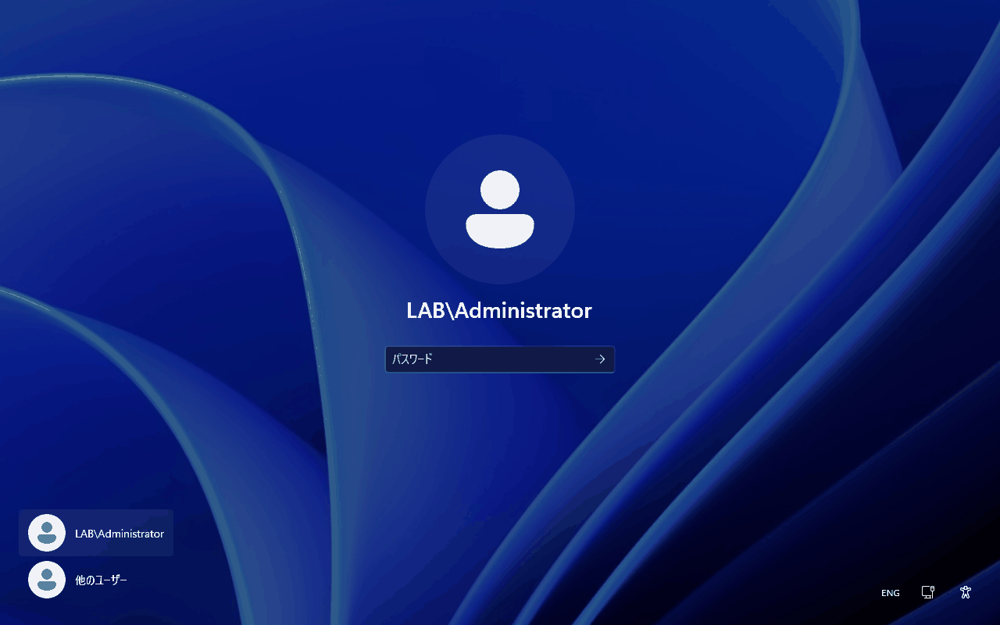

2. サーバーマネージャーの右上 **[ツール] > [グループ ポリシーの管理]** を開く。

   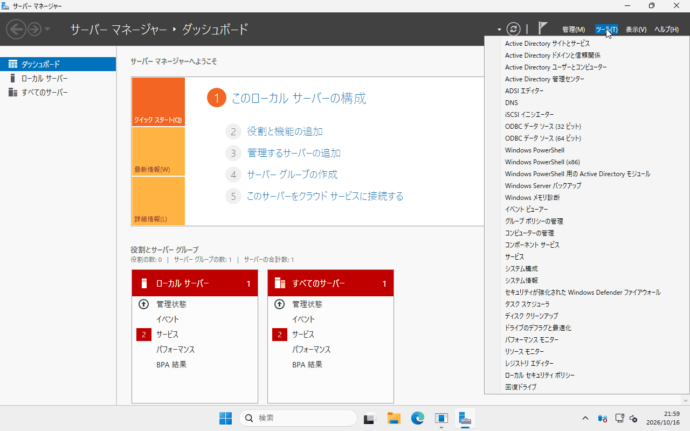

3. 左のツリーを **フォレスト > ドメイン > lab.local** と開き、対象の OU(ここでは `Workstations`)を見つける。

   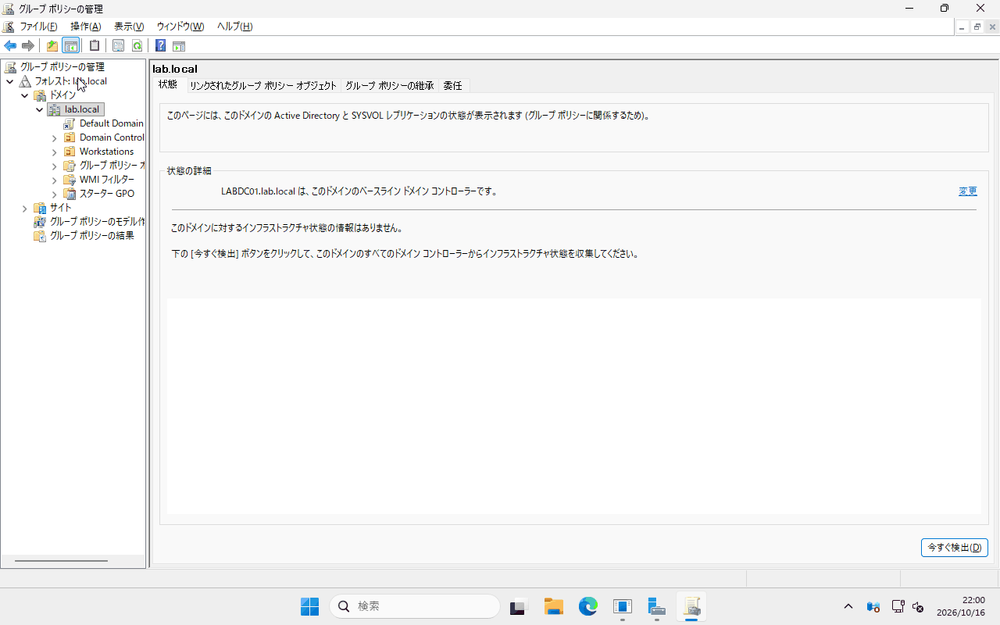

4. OU を右クリックし、**[このドメインに GPO を作成し、このコンテナーにリンクする]** を選ぶ。

   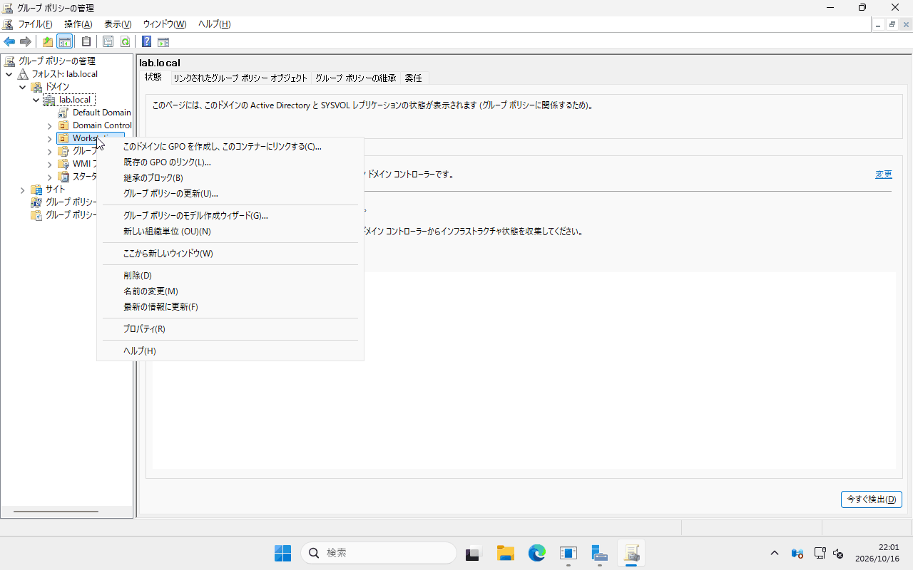

5. 名前に `Firefox-AutoUpdate` と入れて **[OK]**。ソース スターター GPO は `(なし)` のまま。

   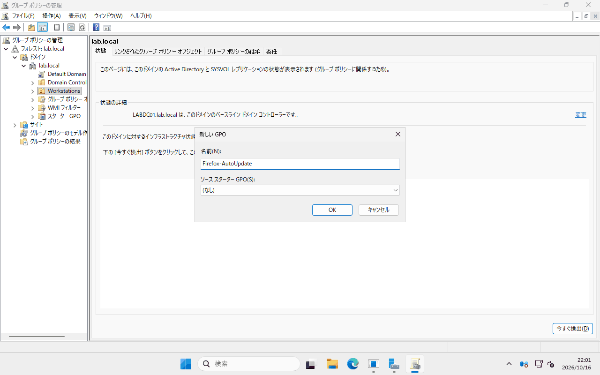

6. OU の下に `Firefox-AutoUpdate` ができ、右側の「リンクされたグループ ポリシー オブジェクト」に `リンクの有効化: はい`、`GPO の状態: 有効` で出る。

   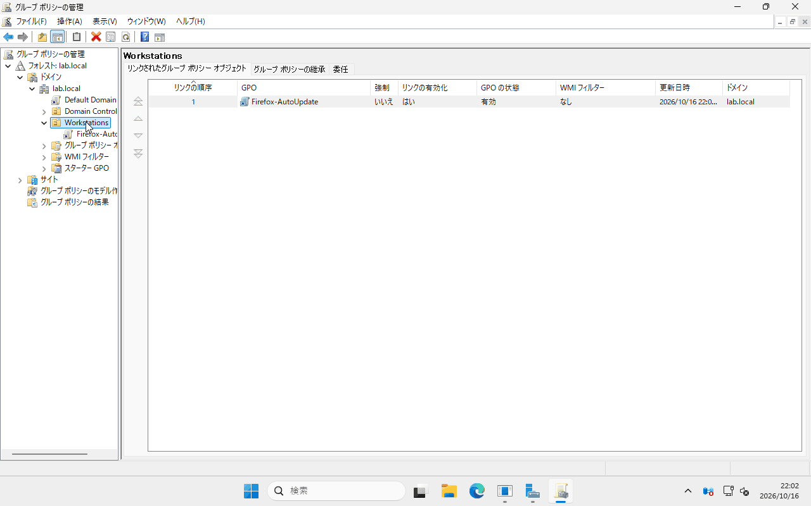

## 手順 2-A. 【方法 A】ADMX を使って自動更新を有効にする

### 2-A-1. Firefox の ADMX を中央ストアに置く

GPO エディターに Firefox の項目を出すために、Mozilla の ADMX をドメインの共有領域(SYSVOL)に置きます。

1. 上の「ADMX のダウンロード先」から `policy_templates_vX.Y.zip` をダウンロードして解凍する。
2. 解凍した `windows` フォルダーには、`firefox.admx`、`mozilla.admx` と、言語フォルダー(`en-US` など)がある。

   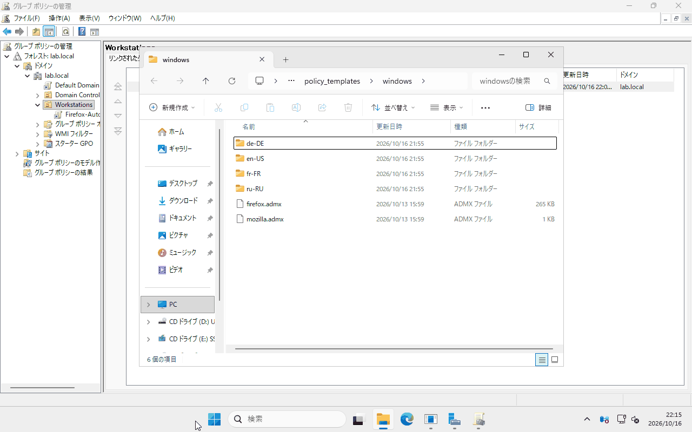

3. DC 上の次のフォルダーを開く(なければ作る)。
   `C:\Windows\SYSVOL\domain\Policies\PolicyDefinitions`
   (ネットワーク上では `\\lab.local\SYSVOL\lab.local\Policies\PolicyDefinitions`)
4. `firefox.admx` と `mozilla.admx` を、この `PolicyDefinitions` に直接コピーする。
5. 言語フォルダー(`en-US`)の `*.adml` を、`PolicyDefinitions\en-US` にコピーする。

   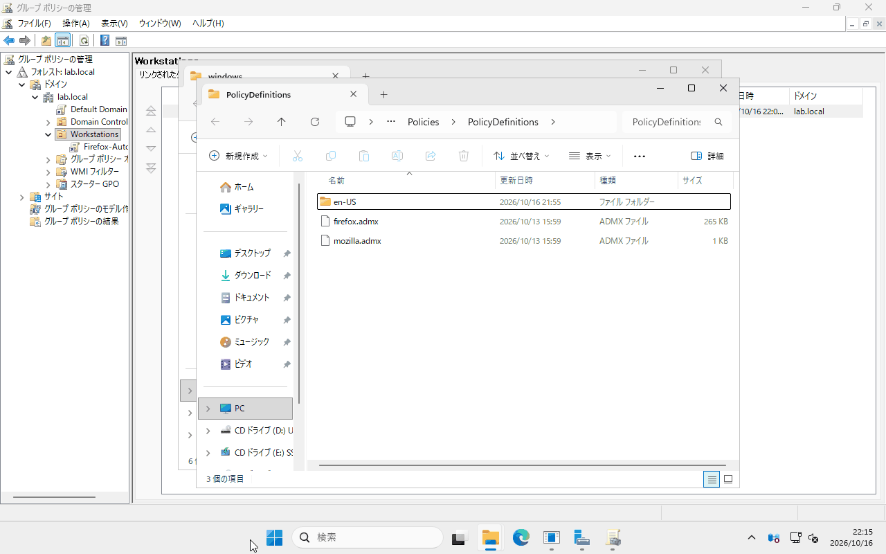

> ⚠️ **本番で最初に中央ストアを作る場合は、先に `C:\Windows\PolicyDefinitions` の中身(Windows 標準のテンプレート)を `PolicyDefinitions` に丸ごとコピーしておく。**
> 中央ストアができると、GPO エディターは中央ストアの中だけを読みます。今回の検証環境のように Mozilla のファイルしか置かないと、「管理用テンプレート」に Windows 標準の項目が出なくなります(後の画面で `Mozilla` と `すべての設定` しか見えないのはこのためです)。

### 2-A-2. GPO を編集して `Application Autoupdate` を有効にする

この手順は 3 つのことをしています。

- ① GPO エディターを開いて「コンピューターの構成 > 管理用テンプレート」を開く(Windows 標準の機能)。
- ② `Mozilla > Firefox` の項目が一覧に出る(**2-A-1 で ADMX を置いたおかげ**)。
- ③ `Application Autoupdate` を「有効」にする(GPO にレジストリ値 `AppAutoUpdate = 1` を書き込む指示になる)。

1. 左のツリーで作った GPO を右クリックし、**[編集]** を選ぶ。

   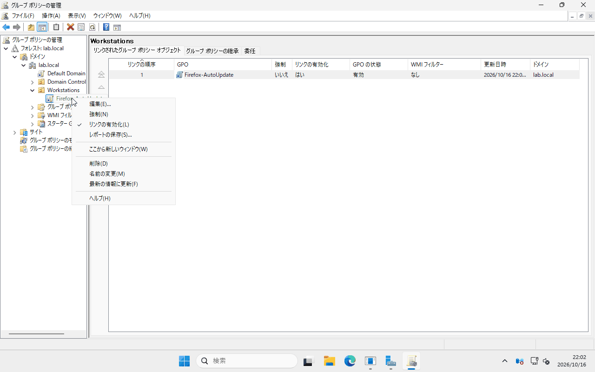

2. グループ ポリシー管理エディターが開く。**[コンピューターの構成] > [ポリシー]** を開くと、`ソフトウェアの設定`、`Windows の設定`、`管理用テンプレート` の 3 つがある。

   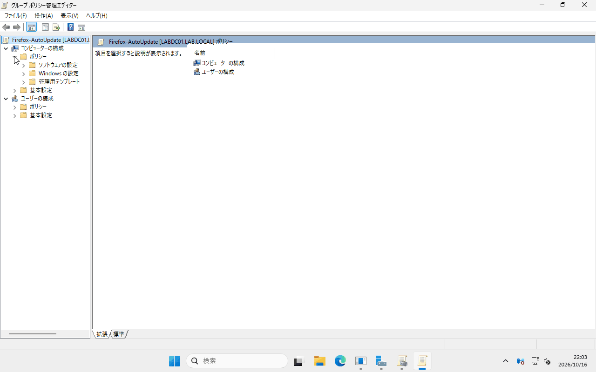

3. **[管理用テンプレート]** を開く。見出しが「管理用テンプレート: セン…(中央ストア)」になり、その下に `Mozilla` が出る(2-A-1 が効いている証拠)。

   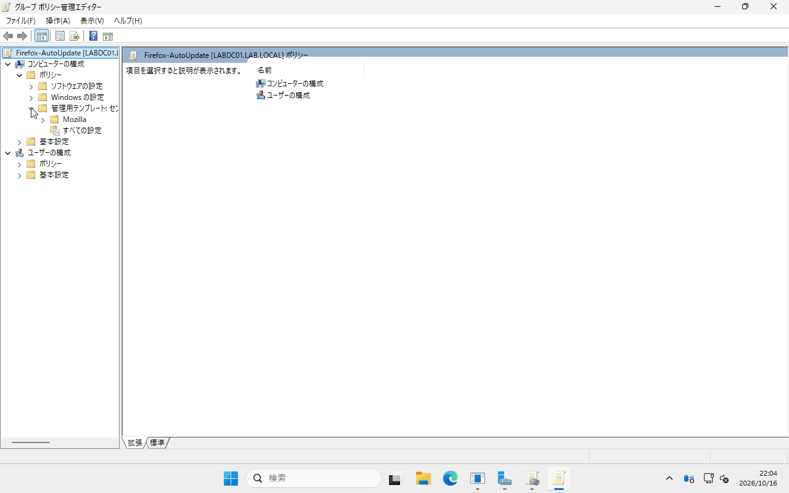

4. **[Mozilla] > [Firefox]** を選ぶ。右側にポリシーが 107 個並ぶ(フォルダーが先、設定は ID 順)。
   更新に関する設定は、一覧の上のほうにある。
   - `Application Autoupdate`(**今回有効にするもの**)
   - `Pin updates to a specific version`、`Custom Update URL`
   - `Background updater`
   - `Disable Update`(有効にすると**更新が止まる**ので触らない)

   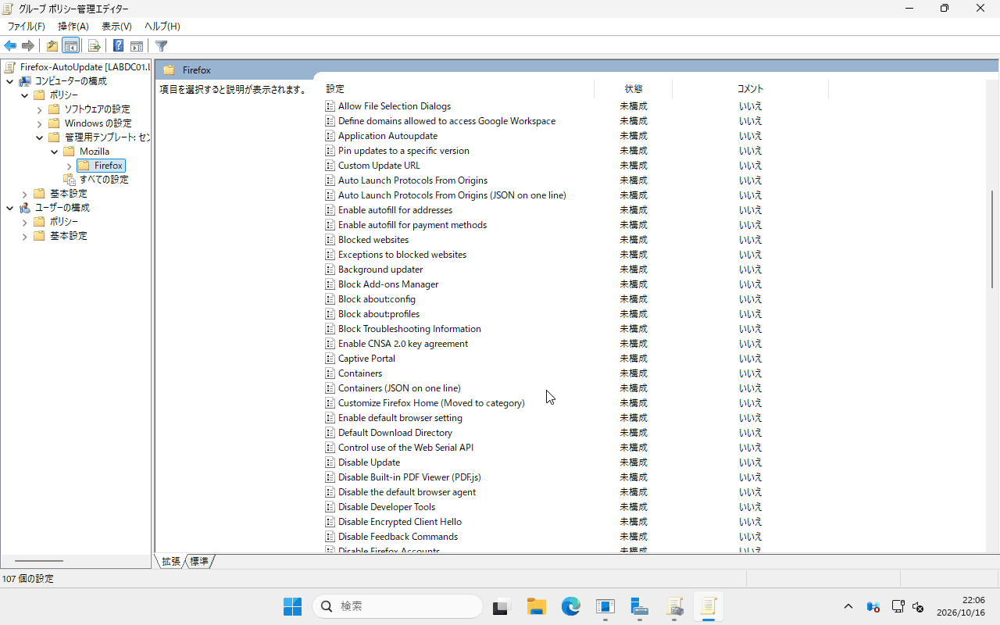

5. `Application Autoupdate` をダブルクリックし、**[有効]** を選んで **[OK]**。
   説明欄の要点: 有効 = ユーザーの承認なしに自動更新される / 無効 = 更新は取得するが、いつ入れるかはユーザーが選ぶ / 未構成 = ユーザーが選べる。

   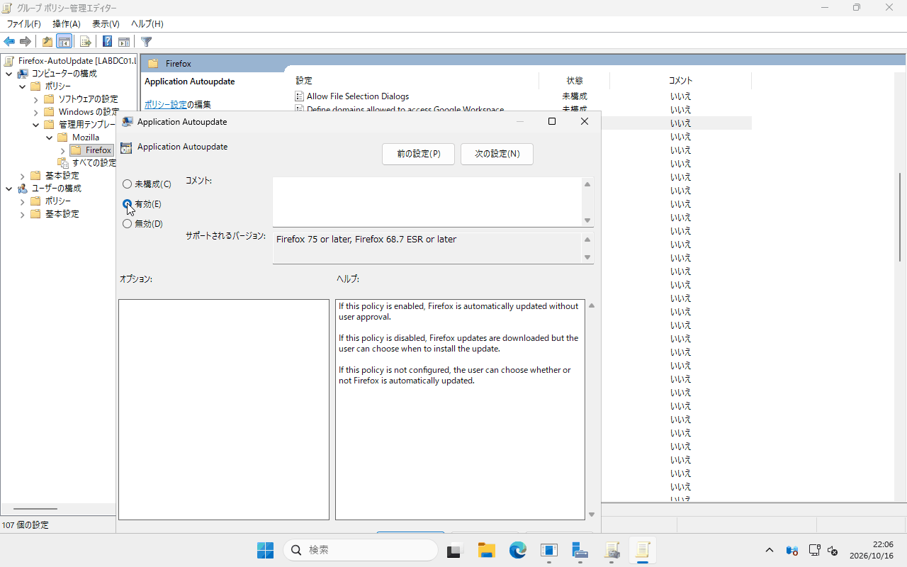

   > 小さい画面(1280×800 など)だと、このダイアログの [OK] ボタンが画面の下にはみ出します。その場合は **Enter キー**で確定できます。

6. 一覧で `Application Autoupdate` の状態が **有効** になっていれば完了。エディターを閉じる(保存は自動)。

   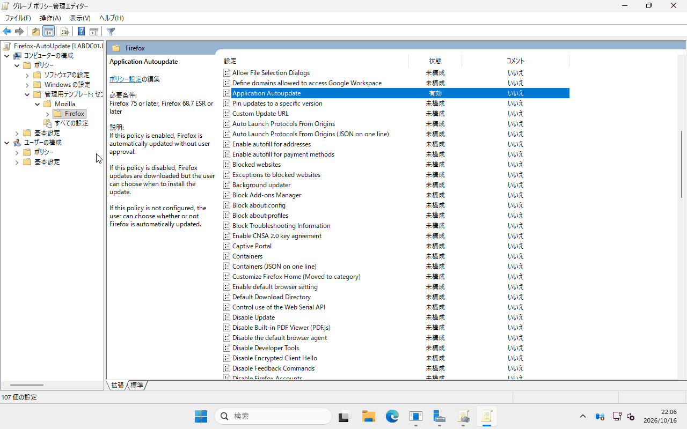

   - `Background updater` は**未構成のまま**にしてあります。説明欄のとおり、未構成は「有効」と同じ扱い(Firefox が起動していないときも、承認なしで更新を入れてよい)です。

## 手順 2-B. 【方法 B】ADMX を使わず、基本設定のレジストリで入れる

ADMX を置かない(または置けない)場合は、GPO の「基本設定」(Group Policy Preferences)で、同じレジストリ値を直接入れます。
この検証では、中央ストアから Firefox の ADMX を外し、元の GPO のリンクも無効にして、**この GPO だけが効く状態**で確認しました。GPO の名前は `Firefox-AutoUpdate-NoADMX` です(作り方は手順 1 と同じ)。

1. GPO を右クリックして **[編集]**。**[コンピューターの構成] > [ポリシー] > [管理用テンプレート]** を開くと、ADMX がないので `Mozilla` の項目は出ず、`すべての設定` だけがある。

   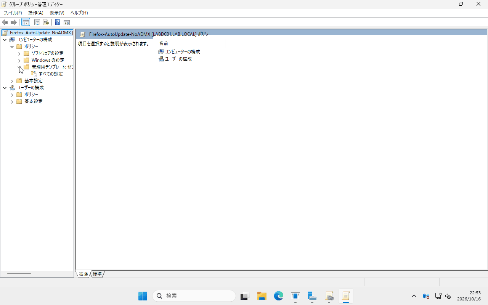

2. 代わりに **[コンピューターの構成] > [基本設定] > [Windows の設定] > [レジストリ]** を開く。

   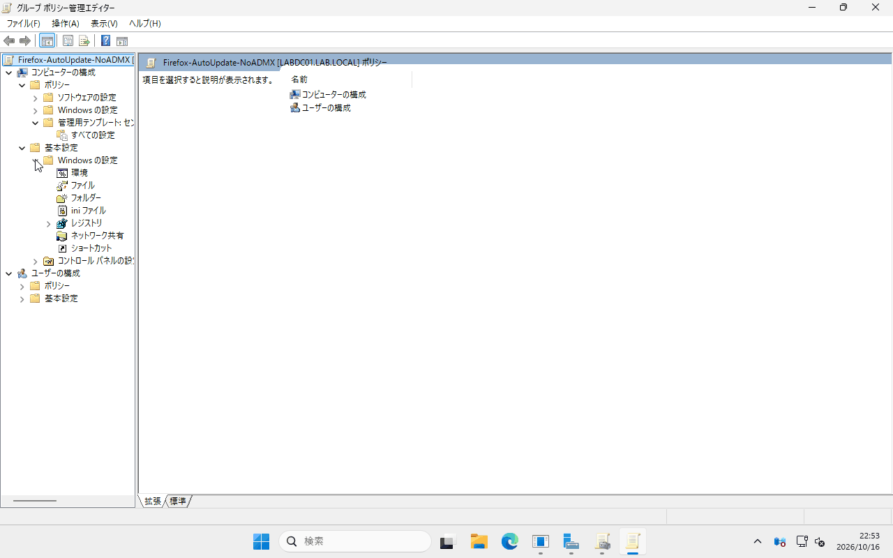

3. **[レジストリ]** を右クリックし、**[新規作成] > [レジストリ項目]** を選ぶ。

   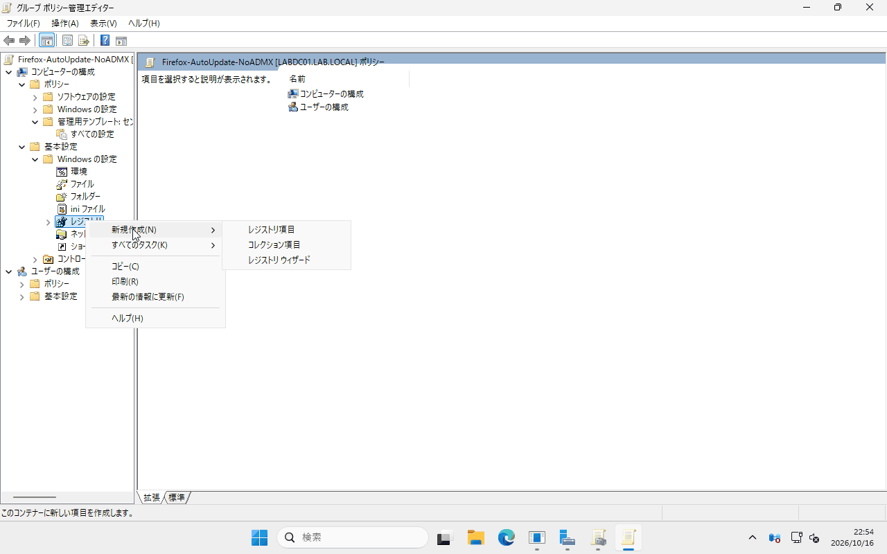

4. 次のとおり入力して **[OK]**。名前は**一字も間違えない**こと。

   | 項目 | 入力する値 |
   |---|---|
   | アクション | 更新 |
   | ハイブ | `HKEY_LOCAL_MACHINE` |
   | キーのパス | `SOFTWARE\Policies\Mozilla\Firefox` |
   | 値の名前 | `AppAutoUpdate` |
   | 値の種類 | `REG_DWORD` |
   | 値のデータ | `1`(表記は 16 進数のままでよい) |

   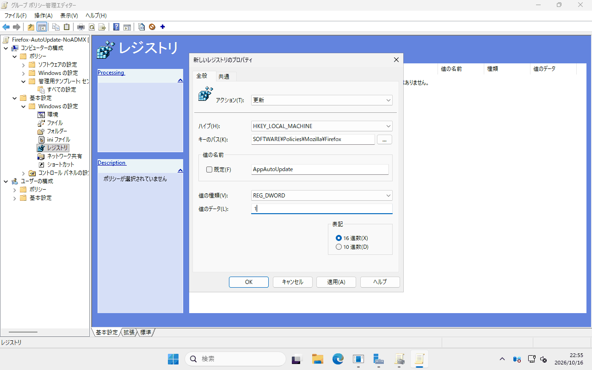

5. 一覧に `AppAutoUpdate`(REG_DWORD、`00000001`)が出れば完了。

   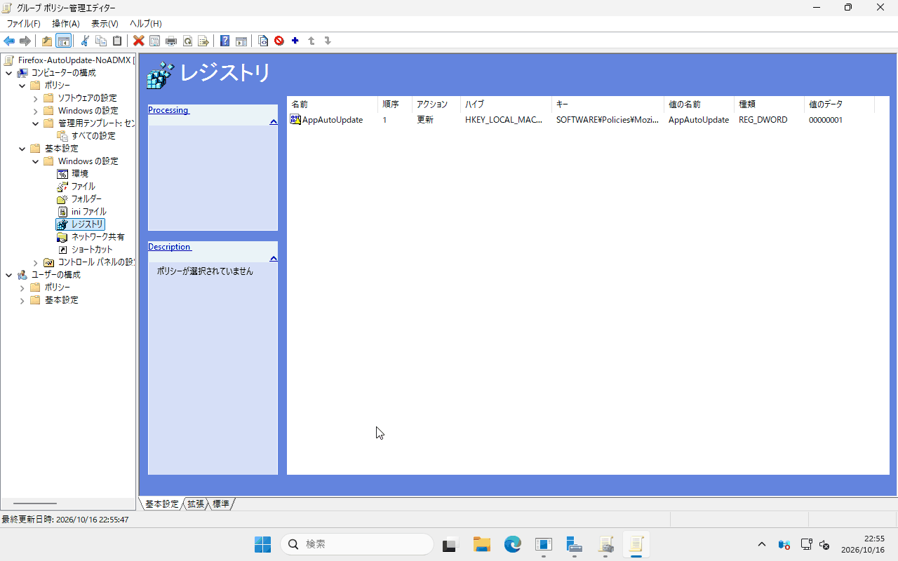

   > 画面ではバックスラッシュ `\` が `¥` で表示されますが、入力するのは `\` です(日本語フォントの表示の違いです)。

## 手順 3. 配られたことを確かめる(方法 A・B 共通)

### 3-1. GPO のスコープを確認する

グループ ポリシーの管理で GPO を選び、**[スコープ]** タブで次を確かめる。
- リンク先が `lab.local/Workstations`、リンクの有効化が `はい`。
- セキュリティ フィルターが `Authenticated Users`(OU 内のすべてのコンピューターに適用)。

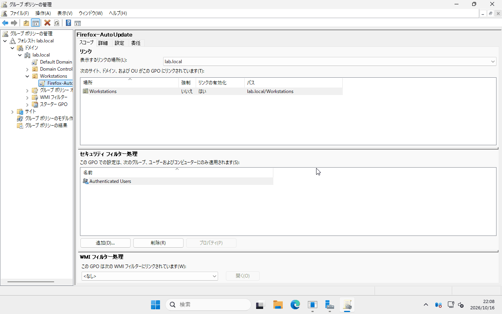

### 3-2. クライアントで確認する

対象 PC(`LABWIN11`)で確認します。コンピューターポリシーは、PC の起動時と、その後 90 分(前後 30 分のゆらぎ)ごとに適用されます。すぐ試すときは次のとおり。

1. 管理者の PowerShell で `gpupdate /force` を実行する(または PC を再起動する)。
2. 適用された GPO を確認する。
   ```powershell
   gpresult /scope computer /r
   ```
   「適用されたグループ ポリシー オブジェクト」に作った GPO が出る。
3. レジストリを確認する。
   ```powershell
   Get-ItemProperty "HKLM:\SOFTWARE\Policies\Mozilla\Firefox" | Select AppAutoUpdate
   ```
   `AppAutoUpdate` が `1`(DWORD)。
4. ドメインのユーザー(ここでは `LAB\labuser`)でサインインする。

   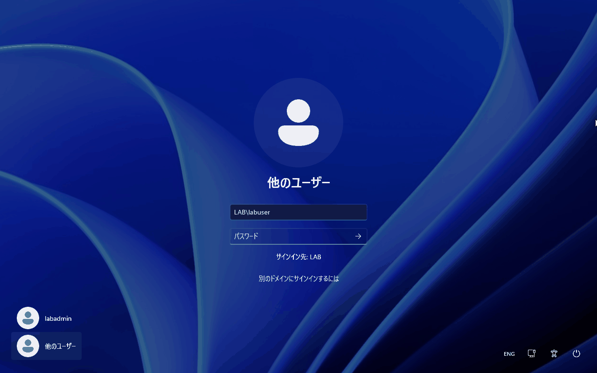

5. Firefox のアドレス欄に `about:policies` と入れる。**「有効」**の一覧に `AppAutoUpdate = true` が出る。
   (Firefox はポリシーを起動時に読むので、すでに起動していた場合は再起動する。方法 A でも方法 B でも同じ表示になりました。)

   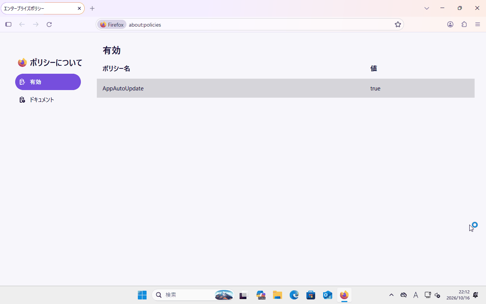

6. Firefox の **[設定] > [Firefox について]** を開く。上部に「**ご使用のブラウザーはあなたの所属組織に管理されています**」と出て、「Firefox の更新」に現在のバージョン(158.0)と更新の状態が出る。

   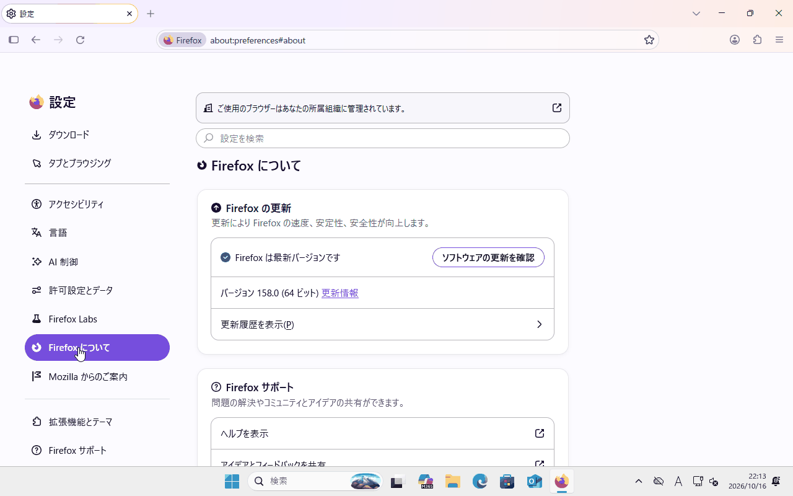

## 補足

### 設定値と意味(Mozilla のテンプレートの説明どおり)

| ポリシー(エディター上の名前) | 値 | 意味 |
|---|---|---|
| Application Autoupdate(`AppAutoUpdate`) | 有効 | 承認なしで自動更新する |
| Background updater(`BackgroundAppUpdate`) | 未構成(既定) | Firefox が起動していなくても更新を入れてよい |
| Disable Update(`DisableAppUpdate`) | 有効にしない | 有効にすると更新が止まる |
| Manual Update Only(`ManualAppUpdateOnly`) | 有効にしない | 有効にすると、手動の更新確認だけになる |

### 元に戻す・止める

- **方法 A の場合**
  - 自動更新をやめる(ユーザーに選ばせる): `Application Autoupdate` を **未構成** に戻す。更新自体を止めたいときは `Disable Update` を有効にする。
  - GPO の **[リンクの有効化]** のチェックを外すと、配布だけ止まる(GPO は残る)。**このとき PC のレジストリ値 `AppAutoUpdate` が消えることを確認済み**です。
- **方法 B の場合**
  - 基本設定のレジストリ項目を削除する、または値を `0` に変えるなど、**明示的に戻す操作が必要になることがあります**。GPO のリンクを外したあとに値が残るかどうかは、この検証では確認していません。実際の環境で確かめてください。

### うまくいかないとき

| 症状 | 確認すること |
|---|---|
| 方法 A: GPO エディターに `Mozilla` が出ない | `firefox.admx` と `mozilla.admx` が `...\Policies\PolicyDefinitions` の直下にあるか。`*.adml` が `PolicyDefinitions\en-US` にあるか(対応する言語フォルダーがないとエラーになる)。 |
| クライアントに GPO が出ない | PC が対象の OU に入っているか(`Get-ADComputer -Filter * \| ft Name,DistinguishedName`)。GPO のリンクが有効か。DNS がドメインコントローラーを向いているか。 |
| レジストリはあるのに `about:policies` に出ない | Firefox を完全に終了して起動し直す。 |
| 方法 B: レジストリに値が入るのに `about:policies` に出ない | キーのパス `SOFTWARE\Policies\Mozilla\Firefox` と値の名前 `AppAutoUpdate` の打ち間違い、値の種類(REG_DWORD)を確認する。 |
| Windows 標準の管理用テンプレートが消えた | 中央ストアに Mozilla のファイルしか置いていない。`C:\Windows\PolicyDefinitions` の内容を中央ストアにコピーする。 |

## この検証で確かめたことと、確かめていないこと

**確かめたこと**
- 方法 A: ADMX を中央ストアに置くと、GPO エディターに `Mozilla > Firefox` が出て、`Application Autoupdate` を有効にできる。DC 側の GPO のレジストリ設定に `Software\Policies\Mozilla\Firefox` の `AppAutoUpdate = 1`(DWORD)が入る(`Get-GPRegistryValue` で確認)。
- 方法 A: 元の GPO のリンクを無効にすると、クライアントのレジストリ値 `AppAutoUpdate` が消える。
- 方法 B: ADMX を中央ストアから外すと、GPO エディターに `Mozilla` が出ない。その状態でも、基本設定のレジストリ項目で `AppAutoUpdate`(REG_DWORD、1)を入れた GPO により、クライアントのレジストリ値が `1` になり、Firefox の `about:policies` に `AppAutoUpdate = true` が出る。`gpresult` でも、適用されたのは方法 B の GPO で、方法 A の GPO は「無効(リンク)」と出た。
- どちらも、クライアントで `gpupdate /force` 後、`gpresult` に対象の GPO が適用済みで出る。

**確かめていないこと**
- **実際に新しいバージョンへ自動更新される動作。** 検証でインストールしたのが最新版(158.0)だったため、更新が走る場面を作れていません。古い版を入れて、更新が自動で入ることを確かめるのが次の検証です。
- **Mozilla Maintenance Service の有無による違い。** 今回の MSI(既定のオプション)では、クライアントに `MozillaMaintenance` サービスは入っていませんでした(`Get-Service MozillaMaintenance` で見つからない)。サービスなしでの自動更新で、UAC の確認が出るかどうかは未確認です。
- 方法 B で GPO のリンクを外したあとに、レジストリ値が残るかどうか。
- 設定画面の「Firefox の更新」で、自動更新の選択肢がユーザーに見えなくなるかどうか(設定前後の比較はしていません)。
- ESR 版や、日本語のテンプレート表示(Mozilla 提供の v8.4 には日本語がない)。

## 付録

### A. ADMX を PowerShell でダウンロードして中央ストアに置く

DC の管理者 PowerShell で実行します(インターネットに出られること)。実際にこの手順で、v8.4 を取得して配置しました。

```powershell
# 最新リリースの zip を取得して解凍
$rel   = Invoke-RestMethod https://api.github.com/repos/mozilla/policy-templates/releases/latest -Headers @{ 'User-Agent' = 'ps' }
$asset = $rel.assets | Where-Object name -like '*.zip' | Select-Object -First 1
New-Item -ItemType Directory -Force C:\work | Out-Null
Invoke-WebRequest $asset.browser_download_url -OutFile C:\work\policy_templates.zip -UseBasicParsing
Expand-Archive C:\work\policy_templates.zip C:\work\policy_templates -Force

# 中央ストアにコピー(ADMX は直下、ADML は言語フォルダーへ)
$store = 'C:\Windows\SYSVOL\domain\Policies\PolicyDefinitions'
New-Item -ItemType Directory -Force "$store\en-US" | Out-Null
Copy-Item C:\work\policy_templates\windows\*.admx $store -Force
Copy-Item C:\work\policy_templates\windows\en-US\*.adml "$store\en-US" -Force
```

### B. 同じことを PowerShell で行う(GUI の代わり・方法 A と同じ GPO を作る)

画面操作の代わりに、DC の管理者 PowerShell で同じ設定ができます(`lab.local` / `Workstations` は読み替え)。
使い捨ての GPO で動作を確かめてあり、GUI で作った GPO と同じレジストリ値(`AppAutoUpdate = 1`)になります。
この方法で GPO に入るのは、方法 A と同じ形の値(ポリシーとして管理される値)で、ADMX は必要ありません(ただし、ADMX を置いていない状態でこのコマンドを試してはいません)。

```powershell
# GPO を作って OU にリンク
$ou = 'OU=Workstations,DC=lab,DC=local'
New-GPO -Name 'Firefox-AutoUpdate' | New-GPLink -Target $ou

# コンピューターの構成: AppAutoUpdate = 1
Set-GPRegistryValue -Name 'Firefox-AutoUpdate' -Key 'HKLM\Software\Policies\Mozilla\Firefox' `
  -ValueName AppAutoUpdate -Type DWord -Value 1

# 確認
Get-GPRegistryValue -Name 'Firefox-AutoUpdate' -Key 'HKLM\Software\Policies\Mozilla\Firefox'
```
